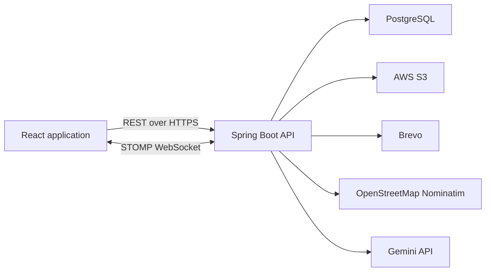

# OpenCircle

**Make plans. Meet people nearby.**

[](https://github.com/abdulkhadir07/open-circle/actions/workflows/backend-ci.yml)
[](https://github.com/abdulkhadir07/open-circle/actions/workflows/frontend-ci.yml)

OpenCircle is a location based social platform for discovering activities, sharing plans, and connecting with people nearby. Instead of building a follower network first, users can publish temporary invite posts, respond to plans, coordinate through real time chat, and build a community reputation through completed interactions.

[Open the live application](https://open-circle-puce.vercel.app)

## Production

| Service | Platform | URL |
| --- | --- | --- |
| Frontend | Vercel | [open-circle-puce.vercel.app](https://open-circle-puce.vercel.app) |
| Backend API | Railway | [backend-production-1f35.up.railway.app](https://backend-production-1f35.up.railway.app) |
| API health | Spring Boot Actuator | [Health check](https://backend-production-1f35.up.railway.app/actuator/health) |
| Database | Railway PostgreSQL | Private |
| File storage | AWS S3 | Private |
| Transactional email | Brevo | Private |

## Features

- Account registration with email verification and password recovery
- Editable usernames, profiles, interests, locations, and profile pictures
- City, state or region, country, and global invite visibility
- Single person and group invite posts
- Invite editing, deletion, tags, and up to four images
- Automatic invite expiration after 24 hours
- Engagement requests with accept, decline, hold, and withdraw actions
- Real time chat after an engagement is accepted
- Chat attachments, saved chats, hidden chats, and participant controls
- Persistent community banter with replies, likes, and moderation controls
- Real time notifications
- Post interaction ratings and public reputation
- Annual scores, leaderboards, and Hall of Fame awards
- AI assisted invite drafting and feed insights with local fallback rules
- Password, email, session, appearance, and privacy settings
- Immediate account deletion with owned data and stored file cleanup

## How It Works

1. Create an account and verify your email.
2. Set and verify your location.
3. Publish an invite for an activity.
4. Choose who can see it based on location.
5. Review requests from interested users.
6. Accept the people you want to include.
7. Coordinate the activity through chat.
8. Leave a rating after the interaction.

## Architecture



The frontend and backend are independently deployable. The frontend communicates with the backend through REST endpoints and a STOMP WebSocket connection. PostgreSQL stores application data, while S3 stores profile images, invite images, and chat attachments.

## Technology

### Frontend

- React 19 and TypeScript
- Vite 8
- React Router
- TanStack Query
- Zustand
- Tailwind CSS
- Radix UI and shadcn components
- React Hook Form and Zod
- Motion
- Axios
- STOMP.js
- Vitest, Testing Library, MSW, and Playwright

### Backend

- Java 21
- Spring Boot 4
- Spring Security
- Spring Data JPA
- Spring WebSocket and STOMP
- PostgreSQL 17
- Flyway
- JSON Web Tokens
- Springdoc OpenAPI
- AWS SDK for Java
- JUnit, Mockito, Spring Boot Test, and Testcontainers

## Repository Structure

```text
open-circle/
├── backend/                 Spring Boot API
│   ├── src/main/java/      Application modules
│   ├── src/main/resources/ Configuration and Flyway migrations
│   ├── src/test/           Unit and integration tests
│   ├── docker-compose.yml  PostgreSQL and Mailpit
│   └── Dockerfile          Production container image
├── frontend/                React application
│   ├── e2e/                Playwright browser tests
│   ├── src/app/            Routing and application shell
│   ├── src/features/       Feature modules
│   ├── src/components/     Shared interface components
│   └── src/test/           Test setup and API mocks
├── docs/                    Product documentation
└── .github/workflows/      Backend and frontend CI
```

## Local Development

### Requirements

- Java 21
- Node.js 24
- npm
- Docker Desktop

### Backend Configuration

Create the ignored file:

```text
backend/src/main/resources/application-local.properties
```

Add local development configuration:

```properties
spring.datasource.url=jdbc:postgresql://localhost:5434/opencircle_db
spring.datasource.username=opencircle
spring.datasource.password=opencircle

app.security.jwt.secret=replace-with-a-local-secret-at-least-32-characters-long
app.session.cookie-secure=false

spring.mail.host=localhost
spring.mail.port=1025
spring.mail.properties.mail.smtp.auth=false
spring.mail.properties.mail.smtp.starttls.enable=false

app.storage.s3.region=us-east-1
app.storage.s3.bucket=replace-with-a-development-bucket
```

Do not commit this file or place production credentials in it.

Start PostgreSQL and Mailpit:

```bash
cd backend
docker compose up -d
```

Start the backend:

```bash
./mvnw spring-boot:run -Dspring-boot.run.profiles=local
```

The API will be available at `http://localhost:8080`.

Local email messages can be viewed through Mailpit at `http://localhost:8025`.

AWS credentials and an accessible development bucket are required only when testing uploads. Gemini configuration is optional because AI features provide built in fallback behavior.

### Frontend

In a second terminal:

```bash
cd frontend
npm ci
npm run dev
```

Open `http://localhost:5173`.

Vite proxies `/api` and `/ws` to the local backend, so frontend environment variables are not required during local development.

## Environment Variables

### Frontend

| Variable | Purpose |
| --- | --- |
| `VITE_API_BASE_URL` | Public production backend URL |
| `VITE_WS_URL` | Public production WebSocket URL |

All `VITE_*` values are included in the browser bundle and must never contain secrets.

### Backend

| Variable | Purpose |
| --- | --- |
| `SPRING_DATASOURCE_URL` | PostgreSQL JDBC URL |
| `SPRING_DATASOURCE_USERNAME` | Database username |
| `SPRING_DATASOURCE_PASSWORD` | Database password |
| `APP_SECURITY_JWT_SECRET` | JWT signing secret |
| `APP_CORS_ALLOWED_ORIGINS` | Allowed frontend origins |
| `APP_SESSION_COOKIE_SECURE` | Enables secure refresh cookies |
| `APP_MAIL_PROVIDER` | Mail provider, such as `brevo` |
| `APP_MAIL_FROM` | Verified sender address |
| `APP_MAIL_FROM_NAME` | Display name for transactional email |
| `BREVO_API_KEY` | Brevo API key |
| `AWS_S3_BUCKET` | S3 bucket name |
| `AWS_REGION` | AWS region |
| `AWS_ACCESS_KEY_ID` | AWS access key |
| `AWS_SECRET_ACCESS_KEY` | AWS secret key |
| `GEMINI_API_KEY` | Optional Gemini integration |

Never commit credentials, API keys, database passwords, or production configuration files.

## API Documentation

With the backend running:

- Swagger UI: `http://localhost:8080/swagger-ui.html`
- OpenAPI document: `http://localhost:8080/v3/api-docs`
- Health endpoint: `http://localhost:8080/actuator/health`

To regenerate frontend API types:

```bash
cd frontend
npm run api:generate
```

The backend must be running before generating types.

## Testing

### Backend

Docker must be running because integration tests use Testcontainers.

```bash
cd backend
./mvnw test
```

### Frontend

```bash
cd frontend
npm run format:check
npm run lint
npm run test -- --run
npm run build
```

Install Chromium and run browser tests:

```bash
npx playwright install chromium
npm run test:e2e
```

## Continuous Integration

GitHub Actions validates pull requests and pushes targeting `develop` and `main`.

Backend CI:

- Sets up Java 21
- Runs the Maven test suite

Frontend CI:

- Installs dependencies with `npm ci`
- Checks formatting
- Runs the linter
- Runs unit and component tests
- Builds the production application
- Runs Playwright tests on desktop and mobile Chromium

## Deployment

- `develop` is the integration branch.
- `main` is the production branch.
- Feature, fix, and chore branches are merged into `develop`.
- Release pull requests merge `develop` into `main`.
- Vercel deploys the frontend from `main`.
- Railway builds and deploys the backend Docker image.
- Flyway applies database migrations during backend startup.

## Security and Privacy

- Passwords and security PINs are hashed with BCrypt.
- Access tokens expire after 15 minutes.
- Refresh sessions are revocable and stored using secure HTTP only cookies.
- Public authentication endpoints use generic responses where necessary to prevent account enumeration.
- CORS is restricted to configured frontend origins.
- Upload types and sizes are validated by both frontend and backend.
- Private S3 objects are accessed through expiring signed URLs.
- Password reset and email verification codes expire and enforce attempt limits.
- Account deletion is immediate and removes account owned data and stored files.

## Project Status

OpenCircle is actively developed and deployed. The production application, backend API, automated tests, deployment pipelines, database migrations, file storage, transactional email, and real time communication are operational.

## License

No open source license has currently been published. All rights reserved.
